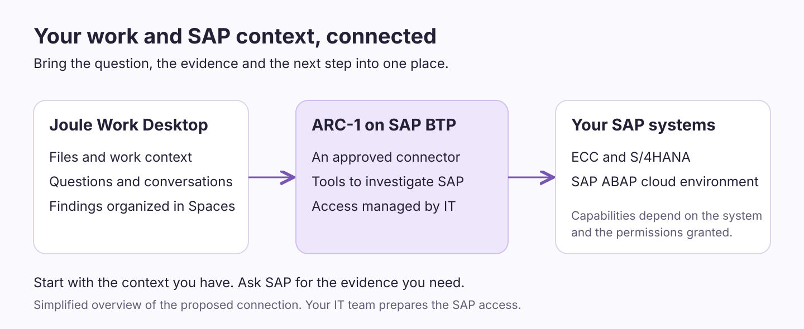
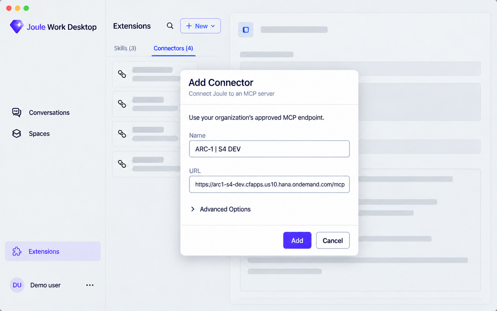
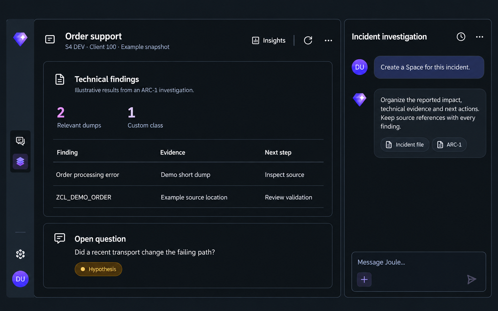

To connect **Joule Work Desktop (JWD) to SAP systems**, add **[ARC-1 on SAP BTP](https://docs.arc-1-mcp.com/btp-cloud-foundry-deployment/)** as an MCP connector, sign in with your work account and select it in a conversation. JWD can then use ARC-1's SAP tools alongside the files and other context you provide.

For ABAP work, ARC-1 is my first choice. It gives the desktop tools to investigate errors, read custom code and understand software changes. Below is the short setup guide and a support workflow that shows why the connection is useful.

MCP, short for Model Context Protocol, lets AI applications use external tools. Your IT team prepares the server and SAP access; you add the connection in the desktop.

## Why connect Joule Work Desktop to SAP?

An email says that order processing failed. A spreadsheet lists the affected cases. The SAP system holds the error details. Bringing those pieces into one conversation gives the investigation a useful starting point.

[Joule Work Desktop](https://www.sap.com/products/artificial-intelligence/joule-work/desktop-app.html) can work with local files, connected services and reusable workspaces called Spaces. SAP's [October Devtoberfest demo](https://www.youtube.com/watch?v=o05bdEqb-SQ&t=1134s) shows how a conversation becomes a Space with cards and follow-up questions alongside it.

ARC-1 adds the SAP evidence: short dumps, relevant code and changes. A short dump is the technical report SAP creates when a program fails, usually investigated in transaction ST22. You can ask JWD to explain that information in plain language, making it useful for consultants and support colleagues as well as developers.

Local file access still involves cloud processing: SAP documents that conversation context is sent to AI models through SAP AI Core. See the [desktop's data-handling guide](https://help.sap.com/docs/JOULE_WORK_DESKTOP/3fec5cf19c7040baa71e42a88099180e/5adde9df7ec7474bb7e406b04d39a2d2.html?locale=en-US).

## Why I recommend ARC-1 as the SAP MCP server

ARC-1 brings several investigation tools into the same connection. You can ask it to retrieve a short dump, inspect the code involved and compare changes in a transport, SAP's way of moving software changes between systems. The [tool reference](https://docs.arc-1-mcp.com/tools/) explains the available capabilities.

That combination matters when the first error message leaves questions open. The conversation can move from what failed to the code behind it, then produce an explanation someone else can check against the evidence.

Deploying ARC-1 centrally on BTP also gives your IT team one place to manage connections and [tool permissions](https://docs.arc-1-mcp.com/authorization/). SAP's own authorization checks still apply.

## Which SAP systems can you connect to?

ARC-1 documents connections for:

- **SAP ECC and S/4HANA on-premise or Private Edition**, with suitable development services and permissions.
- **[S/4HANA Cloud Public Edition](https://docs.arc-1-mcp.com/s4hana-public-cloud/)**, using its developer extensibility environment and an authorized developer user.
- **[SAP BTP / Business AI Platform, ABAP environment](https://docs.arc-1-mcp.com/btp-abap-environment/)**, for ABAP applications in the cloud.

Available tools depend on the system's release, configuration and your access. Your IT team prepares each connection.



This uses the hosting pattern SAP describes as a [custom MCP server on SAP BTP](https://architecture.learning.sap.com/docs/ref-arch/137800#pattern-2-custom-mcp-server-on-sap-btp). Your organization is responsible for operating and securing the deployment. SAP also describes Integration Suite MCP Gateway for central governance of MCP access.

For the administrator's view, see the [ARC-1 deployment guide](https://docs.arc-1-mcp.com/btp-cloud-foundry-deployment/) and my earlier [ARC-1 on BTP article](/posts/2026-04-29-arc-1-btp/).

## How to connect Joule Work Desktop to SAP with ARC-1

Ask your IT team for the deployed ARC-1 connector URL, the OAuth sign-in option and access to the SAP system you need. Once those are ready:

1. Open **Extensions**, choose **New**, then **Add Connector**.
2. Enter a name such as `ARC-1 | S4 DEV` and paste the supplied URL.
3. If prompted, choose the OAuth option specified by your IT team. Select **Add** and complete the sign-in in your browser.
4. Return to JWD, open a conversation and select the ARC-1 connector for that conversation.
5. Ask for details of the connected SAP system to check access before starting your task.

A single-system ARC-1 deployment on BTP Cloud Foundry can use a URL like this [documented example](https://docs.arc-1-mcp.com/deployment-best-practices/#example-enterprise-with-multiple-sap-systems):

```text
https://arc1-s4-dev.cfapps.us10.hana.ondemand.com/mcp
```

Use the complete address supplied by your IT team. The hostname, region and path depend on the deployment; `/mcp` is the path in this example.



**OAuth** handles sign-in through the browser, so you do not paste your SAP password into the conversation. SAP's [connector guide](https://help.sap.com/docs/JOULE_WORK_DESKTOP/3fec5cf19c7040baa71e42a88099180e/8c11ae6508de4b9ea9bea100e106ecfd.html?locale=en-US) covers the desktop options. Your administrator can use the [ARC-1 OAuth guide](https://docs.arc-1-mcp.com/xsuaa-setup/) for configuration and troubleshooting.

## Bring SAP findings into a Space

With the connection ready, attach the issue description and affected-case spreadsheet. A request like this gives JWD a concrete task:

```text
Investigate this order-processing issue using ARC-1.
Check relevant SAP short dumps and the code involved. Do not make changes.
Create a Space with the reported issue, SAP findings and next steps.
Include sources and retrieval times.
Separate confirmed findings from possible explanations.
```

[Spaces](https://help.sap.com/docs/JOULE_WORK_DESKTOP/3fec5cf19c7040baa71e42a88099180e/6a57c3fddaa2435db5ed03fd4775a8a2.html?locale=en-US) organize information into cards with a related conversation. You can ask follow-up questions or update the findings as the investigation progresses.



### What about new orders and changed products?

For order and product data, add an approved business connector using the appropriate SAP business APIs. ARC-1 supplies the ABAP investigation tools. Both can contribute to the same workflow, as described in the [ARC-1 architecture guide](https://docs.arc-1-mcp.com/sap-api-policy-and-architecture/).

Ask to refresh the Space when you need an update. Automatic notifications require a separate automation setup.

## Start with one SAP system

My recommendation is to start with ARC-1 on a development system, with read-only permissions. Take one incident your team already understands and use the desktop to bring the issue description and SAP evidence together. That gives you a concrete way to assess the answers before expanding to more workflows.

*Updated 18 October 2026. SAP's desktop help still carries an Early Adopter Care notice; availability depends on your organization. The UI images are illustrations based on public SAP demos.*

## Useful references

- [Devtoberfest: Joule Work, the new way of working](https://www.youtube.com/watch?v=3MbjM9uuAbo), for the desktop's local files, connectors and Spaces.
- [Devtoberfest: AI Eating Brains](https://www.youtube.com/watch?v=o05bdEqb-SQ&t=2133s), with the Add Connector dialog around 35:33.
- [Custom MCP servers and OAuth in Joule Work Desktop](https://community.sap.com/t5/technology-blog-posts-by-sap/connecting-a-custom-mcp-server-to-joule-work-desktop-a-seamless-and-secure/ba-p/14465266).
- [Integration Suite to S/4HANA with principal propagation](https://community.sap.com/t5/technology-blog-posts-by-sap/principal-propagation-for-mcp-servers-sap-integration-suite-to-sap-s-4hana/ba-p/14488140), including a real desktop demonstration.
- [ARC-1 documentation](https://docs.arc-1-mcp.com/), starting with [BTP deployment](https://docs.arc-1-mcp.com/btp-cloud-foundry-deployment/) and [OAuth setup](https://docs.arc-1-mcp.com/xsuaa-setup/).

Part of my [AI ABAP development series](/tags/ai-abap-development-series/). Also see [ARC-1 with Joule Studio](/posts/2026-05-08-arc-1-joule-studio-clean-core/).
