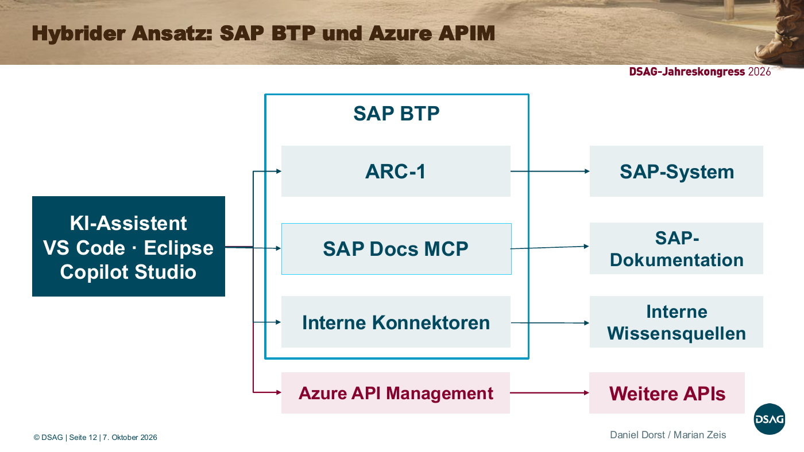
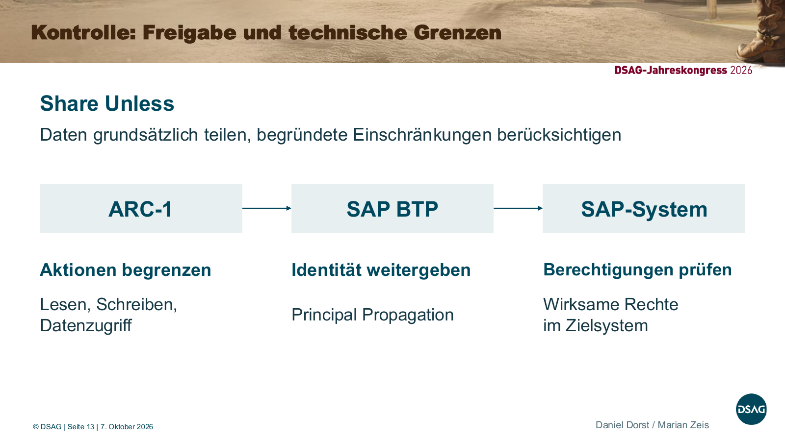

Before I change an ABAP method, I want to know what else calls it. In SAP, I’d open the where-used list. At Siemens, a developer can ask an AI assistant the same question. [ARC-1](https://github.com/arc-mcp/arc-1) lets it look up the answer using that developer’s own SAP permissions.

On 7 October 2026, Daniel Dorst, Development Factory Lead at Siemens AG, and I presented *SAP und KI richtig einordnen: Zwischen Kontext, Kontrolle und Nutzen* at the DSAG Jahreskongress. I built ARC-1 as an open-source server for ABAP systems. Daniel showed how his team uses it in everyday development.

## Understanding code before changing it

From Eclipse or VS Code, a developer can ask the assistant to read a method and follow its dependencies in SAP. If two programs call the same method, what does each expect it to return? Sometimes that answer is all the developer needs.

When a change is needed, the assistant can check SAP’s documentation for the relevant release and the team’s coding guidelines. The team can also save its usual review steps in a reusable skill.

The developer decides whether to accept the change after running syntax checks, the ABAP Test Cockpit (ATC) and ABAP Unit tests.

## Reviewing a transport task

In our [ABAP review workflow](/posts/2026-05-12-arc-1-abap-cicd-review/), an integration opens a GitHub pull request when a developer releases a transport **task**. The diff shows the changed lines. What else might the reviewer need to test?

Suppose a method now returns a different value. A program that expects the old value can break even if its code never appears in the diff. The assistant can use ARC-1 to find that caller in SAP and flag it for testing.

## Investigating a short dump

Did the error start before or after the latest transport? The ABAP short dump in ST22 points to the code that failed. With ARC-1, the assistant can look for earlier occurrences and find transports that touched the affected objects.

On SAP 7.50, ARC-1 can read dump summaries through a feed that can omit dumps older than 24 hours. If you need to know when an error first occurred, check ST22 itself. Support for the feed arrived in [ARC-1 1.10.0](https://docs.arc-1-mcp.com/release-notes/).

Daniel and I discussed what that would mean for an incident in Siemens’ myIT process. The next person would get the affected object, the dump history and a reason to check a particular transport. They could pick up where their colleague left off.

## Whose SAP permissions does the assistant use?

Siemens uses **Principal Propagation** for all developer access to SAP through ARC-1. SAP BTP forwards the developer’s identity, and the SAP backend checks that person’s authorizations on each request. If a developer can’t read an object in SAP, their assistant can’t read it either.

ARC-1 runs on BTP and uses the Model Context Protocol (MCP) to give assistants tools such as ABAP source lookup. Our architecture slide shows where Eclipse, GitHub Copilot in VS Code and Copilot Studio fit in, and how Azure API Management exposes selected APIs.

Say a developer asks Copilot whether a replacement API fits a custom program. Three sources contribute different parts of the answer.

- **ARC-1** shows how the program calls the existing API.
- **SAP Docs MCP** supplies SAP’s documentation for the replacement.
- **Internal connectors** provide the team’s guidelines on which approaches it accepts.

### Where Joule for Developers fits

At our October session, Siemens was evaluating Joule for Developers. The team hadn’t seen an added benefit for these workflows and left the question open.

Later that month at TechEd, SAP outlined agents for ABAP custom code migration, clean-core adaptation and application modernization. Those scenarios give the team something specific to compare in a future evaluation. [SAP’s ABAP update from TechEd](https://community.sap.com/t5/technology-blog-posts-by-sap/agentic-ai-for-abap-development-what-s-new-at-sap-teched-2026/ba-p/14512694).

## Who can enable changes in SAP?

Daniel described Siemens’ approach to sharing knowledge as *Share Unless*. Colleagues should have access unless there’s a specific reason to restrict it. For an assistant to change code, the developer needs permission in SAP and the administrator needs to enable the tool in ARC-1.

An administrator can keep ARC-1 read-only even for developers who can edit code in SAP. Enabling repository changes and activation takes an explicit opt-in, and writes can be limited to selected packages.

Table previews, free SQL and transport writes have separate controls. If a call fails or is denied, operators can check the audit events. [ARC-1 authorization guide](https://docs.arc-1-mcp.com/authorization/).

For teams connecting several SAP systems to one ARC-1 service, version 1.8.0 added a more specific option. An administrator can allow class and interface changes on a Principal Propagation connection pinned to one system and client. The shared connection stays read-only.

To use that option, the administrator must enable writes for the destination and grant the developer write access to that target. [Write access to a pinned SAP target](https://docs.arc-1-mcp.com/multi-target-writes/).

With XSUAA OAuth, users also approve the client application requesting access. ARC-1’s October advisory recommends upgrading XSUAA instances to 1.9.0 or later for explicit approval. [XSUAA release notice and upgrade guidance](https://github.com/arc-mcp/arc-1/releases/tag/v1.9.0).

## How much traffic reaches the SAP backend?

Investigating a single dump can trigger several SAP requests in parallel. ARC-1 gives operators two controls over that traffic.

- **Tool calls per user.** Operators can set a quota on how often each user can call tools. It’s off by default.
- **Concurrent SAP requests.** Operators can cap the requests each ARC-1 process sends at once. If several instances share a backend, their combined traffic matters. [ARC-1 rate-limiting guide](https://docs.arc-1-mcp.com/rate-limiting/).

SAP’s reference architecture, updated on 26 October, places a custom MCP server in a customer-managed SAP Business AI Platform subaccount. The operator is responsible for identity, monitoring and downstream API limits. [SAP reference architecture](https://architecture.learning.sap.com/docs/ref-arch/137800).

For ARC-1, counting tool calls alone would understate the load on SAP whenever a tool makes multiple backend requests. Teams also need to clarify how SAP’s API policy applies to direct ABAP Development Tools (ADT) access. [ARC-1’s assessment of SAP’s architecture and API policy](https://docs.arc-1-mcp.com/sap-api-policy-and-architecture/).

## Where this helps on ECC and S/4HANA

**On ECC**, start with a custom program the team already maintains. Trace its dependencies and ask another developer to check the explanation against the running system. That’s useful even if the team leaves the code as it is.

**During S/4HANA preparation**, start with an ATC migration finding. Which usage did the check flag? Which custom objects depend on it, and where would a replacement need testing? ARC-1 provides [skills for investigating migration findings](https://docs.arc-1-mcp.com/skills/).

What a developer can check in either system depends on its ABAP release, enabled services and user permissions. [ARC-1 deployment guide](https://docs.arc-1-mcp.com/deployment/).

For a team evaluating ARC-1, I’d pick one familiar task, such as reviewing a transport, and use the three questions from our closing slide.

- How long does it take to reach a change the developer has checked?
- How much rework remains?
- What does the review cost once we include model use, operation and developer time?

## Feedback from developers

Feedback on older SAP releases, permissions and BTP deployments helped shape [ARC-1 1.0](/posts/2026-08-03-arc-1-update/). Developers have also built their own tools on top of it. LISA, for example, can run on its own or add three ABAP translation tools to an existing ARC-1 deployment. [LISA project](https://github.com/ClementRingot/LISA).

One recent improvement is handy when tracing dependencies. ARC-1 can now find function-group includes that SAP’s search misses when filtering by include type. That shipped on 7 November in **1.10.1**, the latest public release as of 18 November. [ARC-1 1.10.1 release notes](https://github.com/arc-mcp/arc-1/releases/tag/v1.10.1).

Thanks, Daniel, for sharing how your team works. After the session, many people came over to thank me for ARC-1, ask questions and suggest improvements. I usually see those conversations in GitHub issues. It was great to have them in person.
