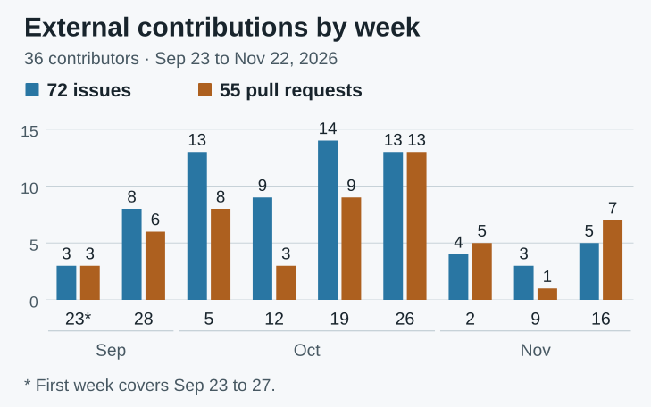

I usually leave minor releases to the [release notes][release]. I'm writing about this release because I've spent the last few weeks working through the open issues and pull requests, and I'd like to give some credit to the people who contributed.

If you're new to [ARC-1][repo], it lets an AI assistant work with an ABAP system through the same interfaces you use in ABAP Development Tools (ADT) for Eclipse. I can test it on my own systems, but I depend on other developers to tell me what breaks on theirs and what they'd like to do with it.

## What came in over two months

Late October was busy. In one week alone, 13 pull requests came in. Fewer arrived in November, and I had time to work through the queue. I tried to reproduce the reported problems, tested proposed fixes, merged some PRs and closed others.[^counts]

## One Cloud Foundry deployment for several SAP systems {#writing-to-more-than-one-sap-system}

Back in August, I was hesitant to let one ARC-1 deployment even *read* from several SAP systems. If the same class existed in DEV and QA, I wanted to know which copy the assistant was reading and whose SAP permissions it was using.

But the more I heard from teams with large SAP landscapes, the more I understood why they wanted this. Setting up a separate ARC-1 instance on SAP BTP Cloud Foundry for every SAP system is already a lot of work. Keeping all those instances configured and up to date is the harder part. With one shared deployment, the team can roll out a new ARC-1 version once.

We took it in steps. Version 1.0 started with reads. In October, 1.8 added writes for classes and interfaces. After several rounds of testing, 1.11 lets you create and update repository objects, edit individual methods and activate your changes. Each write goes through a connection to one specific SAP system and client.[^history]

### An example with DEV and QA

Suppose you need to fix a method in development and compare it with the version in QA. You can set up two connections on the same ARC-1 instance.

- **Development.** Connect to `/DEV/001/mcp` to edit the method and activate the class. Every call on this connection goes to client 001 in DEV.
- **QA.** Connect to `/QAS/001/mcp` to read the same method. You can leave that connection read-only.

### Who can write, and where?

Your administrator enables writes on the ARC-1 server and on the BTP destination for DEV, then gives you write access to DEV. When you save the method, ARC-1 passes your identity through to SAP. SAP checks whether your user is allowed to make that change.

The connection for reading across systems stays read-only. So does any connection that uses a shared SAP account.

One case I wanted to test was a server that allows a whole package tree and a DEV destination that allows just one package in it. **You can edit only that one package.** Your transport request also has to be allowed by both the server and the destination.

All 46 live checks with different package lists passed.[^writechecks]

If the connection drops during a save, SAP may already have made the change. ARC-1 tells the assistant to read the object back before trying again.[^writeguide]

**Multi-system writes are still experimental.** Only some write operations are available so far. Managing transports, publishing a service binding and running the RAP generator still require a single-system connection.

## Limiting access to the office network or VPN

A contributor wanted their team to reach ARC-1 only from the company network.[^allowlist] Think of a developer using VS Code on a laptop. On the company VPN, they can sign in. If they disconnect the VPN and try again over a phone hotspot, ARC-1 returns `403 Forbidden` before it checks their credentials.

To turn this on in SAP BTP Cloud Foundry, put the public IP addresses or ranges for your office and VPN in `ARC1_ALLOWED_CLIENT_IPS`. ARC-1 checks that list against the address Cloud Foundry reports in the [`x-cf-true-client-ip` header][sap-ip].

People on an allowed network still have to sign in. The health endpoint stays reachable so Cloud Foundry can check the application.

Where the MCP client runs makes a difference here. A connector hosted on claude.ai calls ARC-1 from the vendor's cloud. Even if you're sitting in the office, an allowlist containing only your office IPs will block that connector.

If you put a reverse proxy in front of ARC-1, ARC-1 sees the proxy's address. On BTP, other applications in the region may share that outbound address. Before adding it to your list, check what address reaches ARC-1. The [allowlist guide][network-guide] shows how.[^sapip]

## Using your own SAP identity without BTP

Until now, two developers could sign in separately to a shared ARC-1 server in Docker and still appear in SAP as the same technical user. Wouter Lemaire added a way for SAP to recognize each developer by their own account. His [pull request][wouter] includes the setup he built for self-hosted teams.

For an enterprise team, that makes Docker a lot closer to how you'd run ARC-1 on BTP Cloud Foundry. You can operate one central ARC-1 service for the team, and SAP checks each request against the permissions of the developer who made it.

We tested this with Keycloak as the login provider and S/4HANA 2023 as the SAP system.

1. You sign in to Keycloak with your own account.
2. ARC-1 verifies your login and signs a short-lived statement containing your verified email address. This is the SAML bearer assertion.
3. SAP checks the signature, matches the email to your SAP user and applies your authorizations. If the match fails, the request stops.[^saml]

This works without a BTP destination or Cloud Connector. The part I'd review with the SAP identity team is the signing key. SAP trusts ARC-1 to say who signed in, so whoever holds that key can act as any user covered by that trust.

The feature is experimental. Each target needs its own key, certificate and unique SAML provider name. I'd start with one test system and follow the [local SSO setup guide][sso-guide].

## Running SAP's own RAP generators

If you've ever right-clicked a table in Eclipse and chosen **Generate ABAP Repository Objects**, you'll recognize this one. ARC-1 can now run two of SAP's generators for the ABAP RESTful Application Programming Model (RAP). Both start with an active database table.[^wizard]

Choose the UI service if you're building a Fiori elements app. Choose the Web API if another application needs to call the service. For the UI service, I'd start with this request.

> Show me what SAP would generate for a RAP UI service on table ZTRAVEL in package ZTEAM_TRAVEL. Do a dry run so I can review the names first.

There's a good reason to ask for that preview. On S/4HANA 2023, SAP proposed **nine objects** for the UI service, including the CDS views, behavior definitions, draft table and service binding. On ABAP Platform 2025 and the BTP ABAP environment, SAP proposed **fourteen**, including access controls.[^raptests]

After the preview you can adjust the proposed names and choose an existing transport if the package requires one. ARC-1 checks for name collisions, runs the generator and reads back each planned object. You decide when to publish the binding. The [generator reference][gen-guide] includes examples for both service types.

I'd use an [ARC-1 skill][skills] when I want to design a service with several entities and their own behavior. For a table where SAP's standard service is a good starting point, I'd use the generator.

Thomas Kaltbeitzel built the [engine that calls SAP's generators][thomas]. Flavio worked out [how the two RAP generators behave on SAP_BASIS 7.58][flavio]. The [merged PR][merged] shows which parts I took from each. Thank you both for sharing the code and the tests.

## After the update

If you use ARC-1 on BTP with XSUAA, your MCP client may ask you to [sign in again][upgrade] after the update.

And please keep the issues coming. If a generator gives you a different result on your SAP release, for example, I'd like to know which release you're on, what you asked it to generate and what SAP returned. With those details in an [issue][issues], I have somewhere to start.

[^counts]: I counted [new issues][count-issues] and [new pull requests][count-prs] separately, excluding submissions by me, Wouter Lemaire and bots. By release day, 71 of the 72 issues were closed. Of the 55 PRs, 42 were merged and 13 were closed without a merge.
[^history]: [Multi-system reads in 1.0][original] and [the first class and interface writes in 1.8][first-writes].
[^writechecks]: [The 1.11 implementation][write-pr] and [the design decision with live test results][adr].
[^writeguide]: [DEV and QA configuration example][writes]. The [change to write error handling][failures] explains when to read an object back.
[^allowlist]: [The team's request][request] and [the Cloud Foundry implementation][ip-pr].
[^sapip]: SAP Help lists the [outbound Cloud Foundry IP addresses for each region][sap-regions].
[^saml]: [SAP Help on SAML bearer assertions][sap-saml].
[^wizard]: [SAP Help on generating a RAP business service][sap-wizard].
[^raptests]: [Generator results by SAP release][rap-results].

[repo]: https://github.com/arc-mcp/arc-1
[network-guide]: https://docs.arc-1-mcp.com/security-guide/#client-ip-allowlist-sap-btp-cloud-foundry-opt-in
[wouter]: https://github.com/arc-mcp/arc-1/pull/1234
[sso-guide]: https://docs.arc-1-mcp.com/local-sso-experimental/
[gen-guide]: https://docs.arc-1-mcp.com/tools/#rap-service-generator
[skills]: https://docs.arc-1-mcp.com/skills/
[thomas]: https://github.com/arc-mcp/arc-1/pull/1122
[flavio]: https://github.com/arc-mcp/arc-1/pull/1202
[merged]: https://github.com/arc-mcp/arc-1/pull/1279
[release]: https://docs.arc-1-mcp.com/release-notes/#1110-security-fix-rap-service-generator-and-more-object-types-2026-11-22
[upgrade]: https://docs.arc-1-mcp.com/updating/
[issues]: https://github.com/arc-mcp/arc-1/issues
[count-issues]: https://github.com/arc-mcp/arc-1/issues?q=is%3Aissue+created%3A2026-09-22T22%3A00%3A00Z..2026-11-22T21%3A50%3A55Z+-author%3Amarianfoo+-author%3Alemaiwo+-author%3Aapp%2Fdependabot+-author%3Aapp%2Fgithub-actions
[count-prs]: https://github.com/arc-mcp/arc-1/pulls?q=is%3Apr+created%3A2026-09-22T22%3A00%3A00Z..2026-11-22T21%3A50%3A55Z+-author%3Amarianfoo+-author%3Alemaiwo+-author%3Aapp%2Fdependabot+-author%3Aapp%2Fgithub-actions
[original]: /posts/2026-08-03-arc-1-update/
[first-writes]: https://github.com/arc-mcp/arc-1/pull/1080
[write-pr]: https://github.com/arc-mcp/arc-1/pull/1226
[adr]: https://github.com/arc-mcp/arc-1/blob/v1.11.0/docs/adr/0011-broader-pinned-pp-mutations.md
[writes]: https://docs.arc-1-mcp.com/multi-target-writes/
[failures]: https://github.com/arc-mcp/arc-1/commit/3fef4d4ab660daf4c441fba58f4d42ead7880161
[request]: https://github.com/arc-mcp/arc-1/issues/1220
[ip-pr]: https://github.com/arc-mcp/arc-1/pull/1244
[sap-ip]: https://community.sap.com/t5/technology-blog-posts-by-sap/ip-based-allow-listing-for-applications/ba-p/14140136
[sap-regions]: https://help.sap.com/docs/BTP/65de2977205c403bbc107264b8eccf4b/f344a57233d34199b2123b9620d0bb41.html
[sap-saml]: https://help.sap.com/docs/ABAP_PLATFORM_NEW/e815bb97839a4d83be6c4fca48ee5777/236960c96324416c8ed84b2666212d49.html
[sap-wizard]: https://help.sap.com/docs/ABAP_PLATFORM_NEW/fc4c71aa50014fd1b43721701471913d/945d84d4981b427ab5ea9129d344c8d8.html
[rap-results]: https://github.com/arc-mcp/arc-1/blob/v1.11.0/docs/research/2026-11-22-rap-service-generators.md
